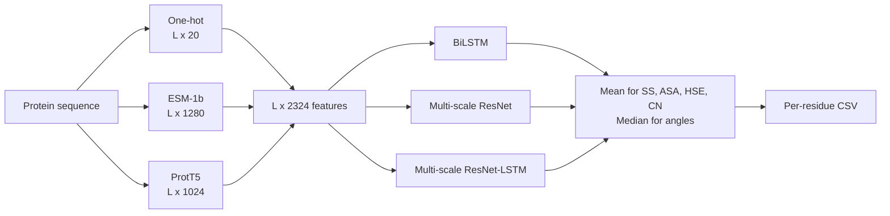

# SPOT-1D-LM

**Profile-level accuracy for protein secondary structure, solvent accessibility, half-sphere exposure, contact number and backbone angles, from a single sequence and two protein language models.**

[](https://doi.org/10.1038/s41598-022-11684-w)
[](https://huggingface.co/Jas-preet/SPOT-1D-LM)
[](https://huggingface.co/datasets/Jas-preet/SPOT-datasets)
[](https://github.com/jas-preet/SPOT-1D-LM/actions/workflows/tests.yml)
[](LICENSE)

Protein language models have emerged as an alternative to multiple sequence alignments for enriching sequence information. SPOT-1D-LM combines one-hot encoding with embeddings from two language models, [ESM-1b](https://github.com/facebookresearch/esm) and [ProtT5](https://github.com/agemagician/ProtTrans), and reaches the accuracy of profile-based methods without building a profile. Skipping the alignment step makes it fast enough for genome-wide analysis.

## Contents

- [Highlights](#highlights)
- [Quick start](#quick-start)
- [What it predicts](#what-it-predicts)
- [Method](#method)
- [Results from the paper](#results-from-the-paper)
- [Installation](#installation)
- [Usage](#usage)
- [Output](#output)
- [Working with the output](#working-with-the-output)
- [Limitations](#limitations)
- [Dataset](#dataset)
- [Related tools](#related-tools)
- [Tests](#tests)
- [Citation](#citation)
- [License](#license)

## Highlights

- **As accurate as profile-based methods, without alignments.** In the paper, 3-state secondary structure accuracy on TEST2018 and TEST2020 is 86.74% and 79.82%. The profile-based SPOT-1D reaches 86.18% and 80.52%, and the single-sequence SPOT-1D-Single 74.28% and 73.80%.
- **Strong on proteins with no homologs.** On Neff1-2020, SS3 is 80.41%, which is 3.8% higher than SPOT-1D-Single and 8.3% higher than SPOT-1D.
- **Best solvent accessibility on every test set.** ASA correlation is higher than both NetSurfP-2.0 and SPOT-1D on all test sets in the paper.
- **Fast.** In the paper, 250 proteins took 0.29 hours on a 16-core CPU and 0.04 hours on a GPU, against more than 16 hours just to build the profiles a profile-based method needs.

## Quick start

```bash
git clone https://github.com/jas-preet/SPOT-1D-LM.git
cd SPOT-1D-LM
pip install -r requirements.txt

curl -LO https://huggingface.co/Jas-preet/SPOT-1D-LM/resolve/main/spot_1d_lm.tar.gz
echo "594e5a140a335cca89640a6bd3c56e8a30e4ebee7e226433b7ce1461721aa97e  spot_1d_lm.tar.gz" | shasum -a 256 -c
tar -xzf spot_1d_lm.tar.gz spot_1d_lm/checkpoints/SPOT-LM-checkpoints.xz
tar -xf spot_1d_lm/checkpoints/SPOT-LM-checkpoints.xz

bash run_SPOT-1D-LM.sh file_lists/test_file_list.txt cpu cpu cpu
```

On Linux, use `sha256sum -c` instead of `shasum -a 256 -c`. The first run downloads ESM-1b (7 GB) and ProtT5 (21 GB).

## What it predicts

For every residue:

| Property | Output | Notes |
| --- | --- | --- |
| Secondary structure, 3-state | `SS3`, `P3C` `P3E` `P3H` | Coil, strand, helix (DSSP) |
| Secondary structure, 8-state | `SS8`, `P8C` … `P8B` | DSSP classes C, S, T, H, G, I, E, B |
| Solvent accessibility | `ASA` | Accessible surface area in Ų |
| Half-sphere exposure | `HseU`, `HseD` | Up and down half-spheres |
| Contact number | `CN` | |
| Backbone torsion angles | `Phi`, `Psi` | Degrees |
| Cα angles | `Theta`, `Tau` | Cα bond angle θ and dihedral τ, in degrees |

## Method

Each residue is described by three features joined together, 2,324 values in all:

| Feature | Size per residue |
| --- | --- |
| One-hot encoding | 20 |
| ESM-1b embedding (34-layer transformer trained on UniRef50) | 1,280 |
| ProtT5-XL embedding (trained on UniRef50) | 1,024 |

These go into an ensemble of three networks, each trained once for classification and once for regression:

| Model | Architecture |
| --- | --- |
| 1 | 2-layer bidirectional LSTM followed by two fully connected layers |
| 2 | Multi-scale ResNet with three parallel stacks of 15 blocks (kernel sizes 3, 5 and 7) |
| 3 | Multi-scale ResNet with one stack replaced by 4 bidirectional LSTM layers |

The ensemble averages the secondary structure probabilities, ASA, HSE and contact number, and takes the median of the angles, as in SPOT-1D.



**Training data:** the SPOT-1D-Single set from ProteinNet, with PDB chains deposited before 2016, resolution below 2.5 Å and clustered at 95% sequence identity. After removing chains longer than 1,024 residues, 38,913 proteins were used for training and 99 for validation.

## Results from the paper

All numbers are copied from [Singh et al., 2022](https://doi.org/10.1038/s41598-022-11684-w). Profile-based methods are in italics. Test sets contain no proteins similar to the training set.

**TEST2018, 250 proteins** (Table 2)

| Method | SS3 (%) | SS8 (%) | ASA | HSE-up | HSE-down | ψ MAE | ϕ MAE | θ MAE | τ MAE |
| --- | --- | --- | --- | --- | --- | --- | --- | --- | --- |
| **SPOT-1D-LM** | **86.74** | **76.47** | **0.814** | **0.759** | **0.761** | **23.74** | **15.99** | **6.46** | **24.60** |
| *SPOT-1D* | *86.18* | *75.41* | *0.787* | *0.732* | *0.737* | *24.87* | *16.88* | *6.91* | *25.94* |
| *NetSurfP-2.0* | *85.35* | *73.48* | *0.783* | — | — | *26.63* | *17.90* | — | — |
| SPOT-1D-Single | 74.28 | 62.17 | 0.665 | 0.573 | 0.563 | 40.58 | 22.16 | 9.35 | 42.32 |
| ProteinUnet | 72.57 | 60.30 | 0.620 | 0.537 | 0.510 | 42.93 | 23.42 | 10.28 | 44.94 |
| SPIDER3-Single | 72.57 | 59.81 | 0.647 | 0.523 | 0.487 | 43.05 | 23.78 | 11.07 | 45.38 |

**TEST2020, 671 proteins** (Table 3)

| Method | SS3 (%) | SS8 (%) | ASA | HSE-up | HSE-down | ψ MAE | ϕ MAE | θ MAE | τ MAE |
| --- | --- | --- | --- | --- | --- | --- | --- | --- | --- |
| **SPOT-1D-LM** | 79.82 | 66.68 | **0.731** | **0.522** | **0.597** | 36.57 | 20.67 | 8.67 | 35.80 |
| *SPOT-1D* | ***80.52*** | ***67.76*** | *0.691* | *0.516* | *0.594* | ***34.46*** | ***20.33*** | ***8.50*** | ***33.64*** |
| *NetSurfP-2.0* | *79.42* | *66.36* | *0.702* | — | — | *35.07* | *20.70* | — | — |
| SPOT-1D-Single | 73.80 | 60.35 | 0.621 | 0.400 | 0.478 | 44.25 | 22.92 | 9.88 | 43.67 |
| ProteinUnet | 72.20 | 58.71 | 0.555 | 0.366 | 0.426 | 44.87 | 23.19 | 10.49 | 44.95 |
| SPIDER3-Single | 71.31 | 57.57 | 0.596 | 0.358 | 0.417 | 45.64 | 23.48 | 11.52 | 46.04 |

ASA, HSE-up and HSE-down are Pearson correlations, and angle errors are mean absolute errors in degrees. The SPOT-1D-Single SS8 value for TEST2018 is taken from the [SPOT-1D-Single paper](https://doi.org/10.1093/bioinformatics/btab316).

**Other findings**

- **Each part of the input helps.** One-hot encoding alone gives 73–76% SS3, and the three features together give 80–86%. Adding one-hot to the two language models gives a small but significant gain.
- **Accuracy doesn't depend on the number of homologs.** Results on TEST2020 and Neff1-2020 (its 46 proteins with no homologs) are nearly identical.
- **CASP14.** On CASP14 free-modelling targets, SPOT-1D-LM beats all other methods, including the profile-based ones, for every property (Supplementary Table S8).
- **Ensembling helps.** On TEST2018, the ensemble is 0.27% (SS3) and 0.52% (SS8) more accurate than the best single model (Table 1).

**Speed on 250 TEST2018 proteins, 16-core Xeon E5-2620 v4**

| Step | Time |
| --- | --- |
| PSI-BLAST profiles (needed by profile-based methods) | 9.3 h |
| HMM profiles (needed by profile-based methods) | 6.9 h |
| SPOT-1D-LM, everything, CPU | 0.29 h |
| SPOT-1D-LM, everything, GPU | 0.04 h |

## Installation

### Requirements

- Python 3 (tested with 3.12) and the packages in `requirements.txt`
- About 16 GB of RAM to generate embeddings on CPU (measured peak: 12.7 GB the first time ProtT5 loads, then 9.9 GB with sequences up to 1,022 residues)
- About 1 GB of RAM for the prediction step on its own (measured peak: 0.7 GB for a 118-residue protein)
- About 30 GB of disk space, because ESM-1b (7 GB) and ProtT5 (21 GB) are downloaded the first time they run
- Optional: an NVIDIA GPU with CUDA

### Code

```bash
git clone https://github.com/jas-preet/SPOT-1D-LM.git
cd SPOT-1D-LM
pip install -r requirements.txt
```

### Checkpoints

Download the checkpoints (956 MB) from [Hugging Face](https://huggingface.co/Jas-preet/SPOT-1D-LM) and check the download:

```bash
curl -LO https://huggingface.co/Jas-preet/SPOT-1D-LM/resolve/main/spot_1d_lm.tar.gz
echo "594e5a140a335cca89640a6bd3c56e8a30e4ebee7e226433b7ce1461721aa97e  spot_1d_lm.tar.gz" | shasum -a 256 -c
tar -xzf spot_1d_lm.tar.gz spot_1d_lm/checkpoints/SPOT-LM-checkpoints.xz
tar -xf spot_1d_lm/checkpoints/SPOT-LM-checkpoints.xz
```

If Hugging Face is unavailable, the same file is on the lab server (plain HTTP only, so keep the checksum check):

```bash
curl -LO http://183.36.5.251:8080/sparks_downloads/servers/downloads/Resource/Protein/2_Protein_local_structure_prediction/spot_1d_lm.tar.gz
```

It is also listed on the [Zhou lab download page](https://zhouyq-lab.szbl.ac.cn/download/).

## Usage

The pipeline takes a file list, then the device for ESM-1b, ProtTrans and the SPOT-1D-LM models, in that order:

```bash
bash run_SPOT-1D-LM.sh file_lists/test_file_list.txt cpu cpu cpu
bash run_SPOT-1D-LM.sh file_lists/test_file_list.txt cpu cpu cuda:0        # only SPOT-1D-LM on GPU
bash run_SPOT-1D-LM.sh file_lists/test_file_list.txt cuda:0 cuda:1 cuda:2  # everything on GPU
```

It runs three steps:

1. `generate_esm.py` saves ESM-1b embeddings to `inputs/<name>_esm.npy`.
2. `generate_prottrans.py` saves ProtT5 embeddings to `inputs/<name>_pt.npy`.
3. `run_inference.py` runs the ensemble and writes `results/<name>.csv`.

The file list has one FASTA path per line, and each FASTA file must contain one sequence. Lower-case letters are accepted, a trailing `*` is removed, and each model encodes residues other than the 20 standard amino acids as unknown or ambiguous. Proteins are identified by FASTA file name, so names in a list must be unique.

To try the prediction step without the language models, use the embeddings included for `5LOS_A`:

```bash
python run_inference.py --file_list file_lists/test_file_list.txt --device cpu
```

`run_inference.py` also accepts `--save_path` for the output directory and `--checkpoints_dir` for checkpoints stored somewhere other than `checkpoints/`.

## Output

Each input produces `results/<fasta file name>.csv`, with one row per residue. These are the first rows of the included example, `results/5LOS_A.csv`:

```text
,AA,SS3,SS8,ASA,HseU,HseD,CN,Psi,Phi,Theta,Tau,...
0,G,C,C,74.87539,0.73815787,8.179948,8.8357315,165.77939,-111.21243,123.07364,-149.1934,...
1,P,C,C,133.15732,1.108063,5.9628434,7.51714,142.64146,-69.74495,109.343864,-102.29597,...
2,G,C,C,70.121254,1.0205184,6.699834,8.163003,122.1322,-96.580315,110.74086,83.137825,...
```

| Column | Meaning |
| --- | --- |
| `AA` | Amino acid |
| `SS3`, `SS8` | Predicted 3-state and 8-state secondary structure |
| `ASA` | Accessible surface area (Ų) |
| `HseU`, `HseD` | Half-sphere exposure, up and down |
| `CN` | Contact number |
| `Psi`, `Phi`, `Theta`, `Tau` | Backbone angles in degrees |
| `P3C`, `P3E`, `P3H` | 3-state probabilities |
| `P8C`, `P8S`, `P8T`, `P8H`, `P8G`, `P8I`, `P8E`, `P8B` | 8-state probabilities |

Earlier versions wrote raw model scores to the `P3` and `P8` columns. They now hold probabilities that sum to 1. The predicted states are unchanged.

Unknown residues have no reference surface area, so their `ASA` value (between 0 and 1) is a placeholder and does not mean the residue is buried.

## Working with the output

Load a prediction with pandas:

```python
import pandas as pd

df = pd.read_csv("results/5LOS_A.csv", index_col=0)

print("".join(df.SS3))                               # secondary structure string
print(df.SS3.value_counts(normalize=True).round(2))  # fraction helix / coil / strand
print(df[["AA", "SS3", "ASA", "Phi", "Psi", "P3H"]].head(3))
```

```text
CCCCCCCCCCCCCHHHHHHHHHHHHHHHHHHHHHHHHHHHHHHHHHHHHHHHHHHHHCCCCCCCCCHHHHHHHHHHHHHHHHHHHHHHHHHHHHHHHHHHHHCCCCCCCCCCCCCCCC
SS3
H    0.68
C    0.32
  AA SS3         ASA         Phi        Psi       P3H
0  G   C   74.875390 -111.212430  165.77939  0.000012
1  P   C  133.157320  -69.744950  142.64146  0.012465
2  G   C   70.121254  -96.580315  122.13220  0.016014
```

The embeddings in `inputs/` are plain NumPy arrays (`L x 1280` for ESM-1b, `L x 1024` for ProtT5), so you can reuse them for your own models.

## Limitations

- ESM-1b accepts up to 1,022 residues, so longer sequences are rejected.
- If you change a sequence, rerun `run_SPOT-1D-LM.sh`. On its own, `run_inference.py` only detects old embeddings when the length has changed.
- Proteins are processed one at a time, because this implementation has only been tested with a batch size of 1.
- The training code is not available.

## Dataset

The training, validation and test data, with the exact splits from the paper and per-residue labels (secondary structure, ASA, angles, HSE and contact number), are on Hugging Face as [Jas-preet/SPOT-datasets](https://huggingface.co/datasets/Jas-preet/SPOT-datasets) (configuration `spot-1d-lm`, the default):

```python
from datasets import load_dataset

ds = load_dataset("Jas-preet/SPOT-datasets", "spot-1d-lm", revision="v1.0")
print(ds)
```

`revision="v1.0"` pins the exact files, so results stay reproducible.

The checkpoint download above also contains the original files: `fasta`, `dssp`, `hse` and `theta` folders with 39,484 files each, plus train, validation and test lists in `lists`. To extract everything, including the checkpoints archive:

```bash
tar -xzf spot_1d_lm.tar.gz
```

| Set | Proteins | Description |
| --- | --- | --- |
| Training | 38,913 | ProteinNet, PDB before 2016 |
| Validation | 99 | Held out from ProteinNet |
| TEST2018 | 250 | Released January–June 2018, < 25% identity to earlier PDB entries |
| TEST2020 / TEST2020-HQ | 671 / 124 | Released May 2018 – April 2020, no detectable homology to earlier PDB entries |
| Neff1-2020 | 46 | TEST2020 proteins with no homologs (Neff = 1) |
| CASP12-FM / CASP13-FM / CASP14-FM | 22 / 17 / 15 | Free-modelling targets |

## Related tools

| Tool | Input | Predicts | Use it when |
| --- | --- | --- | --- |
| [SPOT-1D-Single](https://github.com/jas-preet/SPOT-1D-Single) | Sequence | The same 1D properties, less accurately | You need fast, light predictions (under 1 GB of RAM) |
| **SPOT-1D-LM** (this repo) | Sequence plus ESM-1b and ProtT5 embeddings | 1D structural properties | You want the best accuracy without alignments |
| [SPOT-Contact-LM](https://github.com/jas-preet/SPOT-Contact-LM) | Sequence, ESM-1b and SPOT-1D-Single output | Residue contact map | You need contacts for structure modelling |

## Tests

The tests use random weights and stand-ins for the language models, so they don't need any downloads.

```bash
pip install pytest
pytest
```

## Citation

If you use SPOT-1D-LM, please cite:

Singh J, Paliwal K, Litfin T, Singh J, Zhou Y. Reaching alignment-profile-based accuracy in predicting protein secondary and tertiary structural properties without alignment. *Scientific Reports*. 2022;12:7607. [doi:10.1038/s41598-022-11684-w](https://doi.org/10.1038/s41598-022-11684-w)

```bibtex
@article{singh2022spot1dlm,
  title   = {Reaching alignment-profile-based accuracy in predicting protein secondary and tertiary structural properties without alignment},
  author  = {Singh, Jaspreet and Paliwal, Kuldip and Litfin, Thomas and Singh, Jaswinder and Zhou, Yaoqi},
  journal = {Scientific Reports},
  volume  = {12},
  pages   = {7607},
  year    = {2022},
  doi     = {10.1038/s41598-022-11684-w}
}
```

Please also cite [ESM-1b](https://github.com/facebookresearch/esm) and [ProtTrans](https://github.com/agemagician/ProtTrans), which provide the input embeddings.

## License

[MIT](LICENSE)
